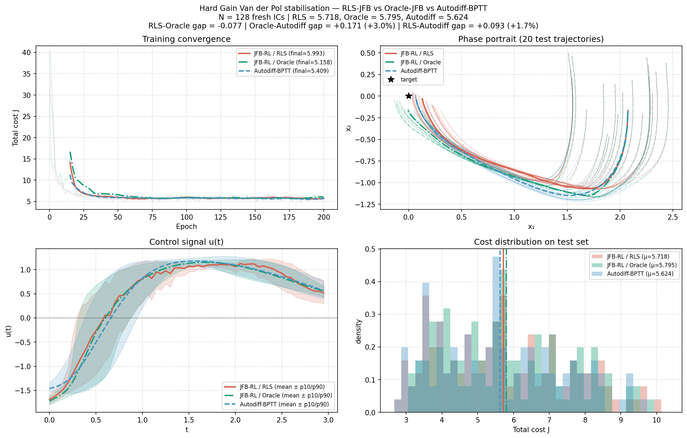

# Implicit Hamiltonian Optimal Control with Unknown Dynamics

Research code for learning feedback policies through an implicit optimal-control
layer, extending **Jacobian-Free Backpropagation (JFB)** to settings where the
agent observes transitions but cannot evaluate or differentiate the dynamics.

Developed as a joint master's project at **ETH Zurich** by **Marin Hanachowicz,
Ignacio E. Adrogué, Hector Stekelorom and François Barré**.

[Project report](ML_for_finance_complex_systems.pdf) ·
[Experiment guide](docs/EXPERIMENTS.md) ·
[Architecture and development](DEVELOPERS.md) ·
[Research interview presentation](presentation_m/README.md)

## Research overview

The starting point is the implicit-Hamiltonian framework of Gelphman et al.
A neural value surrogate supplies a costate, an inner fixed-point solve produces
the control, and JFB approximates differentiation through that implicit layer.

The central extension in this project replaces the unavailable dynamics
Jacobians with **online recursive least squares (RLS) estimates** fitted from
observed transitions. These estimates enter both the implicit control operator
and a backward adjoint used to construct the training surrogate.

| Component | Role in the project |
| --- | --- |
| Implicit Hamiltonians and JFB | Inherited method and implementation from Gelphman et al. |
| Unknown-dynamics extension | Transition interface, local Jacobian estimation, estimated adjoint and JFB surrogate |
| Van der Pol stabilization | Main RL benchmark, with quadratic, exponential-penalty and state-dependent-gain variants |
| Portfolio allocation | Scalar financial sanity check with an implicit optimality condition |
| Almgren–Chriss liquidation | Application and reproduction of the original optimal-control framework |
| Stochastic prices | Separate liquidation extension with Euler–Maruyama rollouts and diffusion diagnostics |

The RL setting assumes a fully observed state and known differentiable running
and terminal costs. The dynamics are hidden from the learner behind an
environment interface; the benchmark designer still knows them for simulation
and reference comparisons. The displayed RL experiments use deterministic
transitions. This is a research implementation, not a trading system.

## Method

For a finite-horizon problem, the policy minimizes

$$
J(\theta)=\mathbb E_{z_0\sim\rho}
\left[\sum_{k=0}^{N-1}\Delta t\,L(t_k,z_k,u_{\theta,k})+G(z_N)\right],
\qquad z_{k+1}=F(t_k,z_k,u_{\theta,k}).
$$

Using the minimization convention $H=L+p^\top f$, the value network supplies
$p_\theta=\nabla_z\phi_\theta$. The implicit policy solves a projected fixed point:

$$
u_{\theta,k}=\widehat T_{\theta,k}(u_{\theta,k};z_k),\qquad
\widehat T_{\theta,k}(u;z)=\Pi_U
\left[u-\alpha_{\mathrm{fp}}\left(\nabla_u L+b_kp_\theta\right)\right].
$$

RLS fits an affine one-step model at each time index. Its discrete coefficients
are converted to continuous-time derivatives:

$$
a_k=\frac{A_k^{\mathrm{disc}}-I}{\Delta t}\approx\partial_z f,
\qquad b_k=\frac{(B_k^{\mathrm{disc}})^\top}{\Delta t}\approx(\partial_u f)^\top.
$$

Training combines an exploration rollout for identification, a clean rollout
for the objective, an estimated backward adjoint, and backpropagation through a
scalar JFB surrogate. The environment transitions are detached from autograd.
See [DEVELOPERS.md](DEVELOPERS.md) for the implementation boundaries and notation.

## Representative results and interpretation



The checked-in Hard Gain Van der Pol figure reports the following mean costs on
128 held-out initial conditions. Lower is better.

| Method | Mean test cost | Dynamics access |
| --- | ---: | --- |
| RLS-JFB | 5.718 | Observed transitions and estimated derivatives |
| Oracle-JFB | 5.795 | Analytical dynamics Jacobians |
| Direct MLP with BPTT | 5.624 | Differentiable benchmark dynamics |

RLS-JFB is approximately **1.7% above BPTT in this displayed run**. The result
supports feasibility on this instance, with several qualifications:

- RLS evaluation includes eight identification warm-up rollouts on the test
  batch before scoring. It therefore includes adaptation of the estimator.
- BPTT uses a direct MLP policy, rather than the same implicit architecture.
  Its final-cost gap does not isolate JFB approximation error.
- The standard Van der Pol export has a larger RLS–BPTT gap of **13.7%**.
  A single favorable run does not establish equivalence or robustness across seeds.
- Descent with simultaneous JFB and Jacobian-estimation errors remains a
  **conjecture**, not a proved guarantee of this extension.

The [report](ML_for_finance_complex_systems.pdf) provides the project narrative.
The [interview deck notes](presentation_m/README.md#conventions-et-précisions-scientifiques)
record discrepancies found between the report and the implementation, including
sign conventions, baseline architecture and evaluation protocol. Read the
reported numbers as results of the exported runs, not as a claim that the current
defaults reproduce every figure exactly.

## Repository architecture

```text
jfb-RL-stochastic-control/
├── README.md                         Research overview and entry points
├── DEVELOPERS.md                     Architecture, contracts and extension guide
├── ORIGINAL-AUTHORS.md               Upstream attribution and references
├── ML_for_finance_complex_systems.pdf Project report
├── requirements.txt                 Python dependencies
├── .python-version                  Python 3.12
├── docs/
│   └── EXPERIMENTS.md                Commands, configurations and output layout
├── jfb-for-implicit-oc/
│   ├── core/                        Known-dynamics optimal control and implicit nets
│   ├── core_RL/                     Environment, RLS, implicit RL policy and trainer
│   ├── models/                      Finance and dynamical-system problem definitions
│   ├── examples/                    Original examples and liquidation application
│   │   └── explicit_ustar/          Analytical/BVP reference comparisons
│   ├── examples-RL/                 RL training, evaluation and visualization scripts
│   ├── benchmarking/               Trajectories, solvers, metrics and plotting
│   │   └── tests/                   Existing benchmark and stochastic-extension tests
│   └── results/                    Generated outputs, created at runtime and ignored
├── presentation/                    Full project Slidev deck
│   └── public/images/              Canonical project figures and animations
├── presentation_m/                  RL-focused interview deck, 10 minutes + appendices
│   └── public/images/              Self-contained subset of presentation evidence
├── latex/                           Optimal-control notes and supporting figure
└── archive/                         Historical source snapshot, outside the active code
```

| Directory | Responsibility | Useful entry point |
| --- | --- | --- |
| `core/` | OC contracts, value network, fixed-point policy, training and artifact naming | [ImplicitOC.py](jfb-for-implicit-oc/core/ImplicitOC.py) |
| `core_RL/` | Unknown-dynamics interface, estimation and surrogate training | [ImplicitOC_RL.py](jfb-for-implicit-oc/core_RL/ImplicitOC_RL.py) |
| `models/` | Dynamics for benchmark construction, known costs and plotting adapters | [Hard_Gain_VDP_RL.py](jfb-for-implicit-oc/models/Hard_Gain_VDP_RL.py) |
| `examples-RL/` | Experiment-specific configurations and baseline comparisons | [hard_gain_vdp.py](jfb-for-implicit-oc/examples-RL/hard_gain_vdp.py) |
| `benchmarking/` | Shared trajectory representation, reference solvers and diagnostics | [trajectory.py](jfb-for-implicit-oc/benchmarking/trajectory.py) |

The Python directory is a source tree used by scripts, rather than an installed
package. Existing runners add the relevant directories to their import path.

## Installation

Use **Python 3.12**, as recorded in `.python-version`. CUDA is optional; CPU
runs are supported but training can take substantial time. The plotting and
convex-policy dependencies are included in `requirements.txt`.

```bash
git clone https://github.com/hanachowicz-adrogue/jfb-RL-stochastic-control.git
cd jfb-RL-stochastic-control
python -m venv .venv
```

Activate the environment:

```bash
# Linux / macOS
source .venv/bin/activate
```

```powershell
# Windows PowerShell
.\.venv\Scripts\Activate.ps1
```

Then install the dependencies:

```bash
python -m pip install -r requirements.txt
```

For the documented test workflow and numerical references, also install:

```bash
python -m pip install pytest scipy
```

The Python dependencies use minimum versions, not a fully pinned environment.
Record the installed versions and hardware when comparing experiments.

## Running experiments

Run these commands from the repository root. The three Van der Pol scripts
train their comparison methods; they are not quick plotting-only commands.

```bash
# Main RL benchmark: state-dependent control gain
python jfb-for-implicit-oc/examples-RL/hard_gain_vdp.py

# Standard and exponential-penalty variants
python jfb-for-implicit-oc/examples-RL/vanderpol_comparison.py
python jfb-for-implicit-oc/examples-RL/hard_vdp_comparison.py

# Portfolio training, then evaluation of the generated checkpoint
python jfb-for-implicit-oc/examples-RL/portfolio_optimization_RL.py
python jfb-for-implicit-oc/examples-RL/evaluate_portfolio_rl.py

# Inspect the liquidation runner's command-line options
python jfb-for-implicit-oc/examples/explicit_ustar/plot_liquidation_jfb.py --help
```

RL comparison parameters are set in each script's configuration section. The
liquidation runner exposes CLI flags. The [experiment guide](docs/EXPERIMENTS.md)
documents both interfaces, the reference 20-asset run, and generated files.

## Presentations

Both decks use Slidev and require Node.js 18 or later and npm. Their dependencies
are installed separately; the interview deck can be used without the full deck.

```powershell
# Full project presentation
cd presentation
npm.cmd ci --include=dev --bin-links=true
npm.cmd run dev
```

```powershell
# Interview presentation, from the repository root
cd presentation_m
npm.cmd ci --include=dev --bin-links=true
npm.cmd run dev
```

On Linux/macOS, use `npm` instead of `npm.cmd`. The full deck uses the default
Slidev address shown in the terminal; the interview deck uses
<http://localhost:3030>. See the [full-deck guide](presentation/README.md) and
[interview guide](presentation_m/README.md) for speaker notes and build commands.

## Validation and reproducibility

Existing tests cover trajectory data structures, plotting, analytical/BVP
references and stochastic-extension components. Instructions are in
[docs/EXPERIMENTS.md](docs/EXPERIMENTS.md#existing-tests). Their presence does
not establish the conjectured descent property of the RL extension.

For a research comparison, retain the configuration, training and noise seeds,
test-time identification protocol, dependency versions and hardware, together
with checkpoints and histories. Generated runs live under
`jfb-for-implicit-oc/results/` and are excluded from Git. The committed figures
are presentation/report exports, not a replacement for raw experiment histories.

## Attribution and citation

This work builds on Gelphman, Verma, Yang, Osher and Wu Fung's implicit optimal
control code and the JFB method of Wu Fung et al. Attribution and upstream
BibTeX entries are retained in [ORIGINAL-AUTHORS.md](ORIGINAL-AUTHORS.md).
The RLS/Pontryagin perspective is discussed in the report with reference to
Eberhard, Vernade and Muehlebach.

For the joint project, cite the supplied report:

```bibtex
@misc{hanachowicz_implicit_hamiltonian_project,
  title        = {Implicit Hamiltonian Optimal Control with Unknown Dynamics
                  via Jacobian-Free Backpropagation},
  author       = {Hanachowicz, Marin and Adrogu{\'e}, Ignacio E. and
                  Stekelorom, Hector and Barr{\'e}, Fran{\c c}ois},
  howpublished = {Master's project report, ETH Zurich},
  url          = {https://github.com/hanachowicz-adrogue/jfb-RL-stochastic-control}
}
```

The supplied PDF is a project report. Its use of a conference-style template
does not imply peer-reviewed publication or acceptance. No repository-wide
license file is currently provided; preserve upstream attribution and verify
applicable permissions before redistributing the code.
